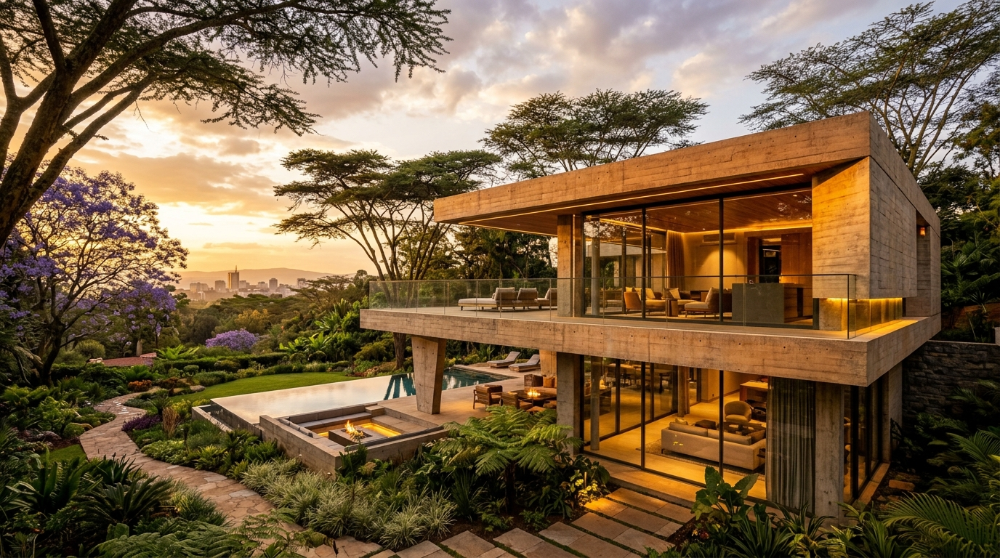
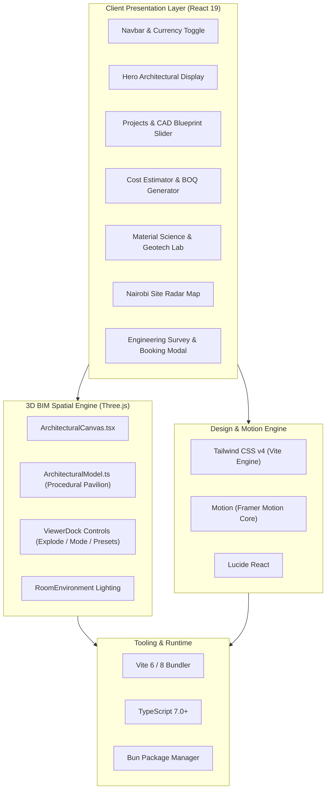

# 🏛️ JENGA | Master Builders & Structural Engineering Nairobi

<p align="center">
  
</p>

<p align="center">
  <strong>Nairobi's Premier Construction, Civil Engineering & Bespoke Architectural Firm</strong><br>
  <em>Delivering ultra-luxury residential villas, commercial high-rises, and sustainable infrastructure engineered for East African geography.</em>
</p>

<p align="center">
  <a href="#-key-features"></a>
  <a href="#-key-features"></a>
  <a href="#-key-features"></a>
  <a href="#-key-features"></a>
  <a href="#-key-features"></a>
  <a href="#-accreditations--compliance"></a>
  <a href="#-license"></a>
</p>

---

## 📑 Table of Contents
- [Overview](#-overview)
- [Key Features](#-key-features)
  - [1. Real-Time 3D BIM Pavilion & Structural Explorer](#1-real-time-3d-bim-pavilion--structural-explorer)
  - [2. Nairobi Construction Feasibility & BOQ Estimator](#2-nairobi-construction-feasibility--boq-estimator)
  - [3. Interactive CAD Blueprint vs. Build Slider](#3-interactive-cad-blueprint-vs-build-slider)
  - [4. Structural Material Science & Geotech Lab](#4-structural-material-science--geotech-lab)
  - [5. Nairobi Active Construction Radar & Drone Telemetry](#5-nairobi-active-construction-radar--drone-telemetry)
  - [6. High-Trust Engineering Consultation Flow](#6-high-trust-engineering-consultation-flow)
- [Design System & Aesthetics](#-design-system--aesthetics)
- [Tech Stack](#-tech-stack)
- [Project Architecture](#-project-architecture)
- [Quickstart & Installation](#-quickstart--installation)
  - [Prerequisites](#prerequisites)
  - [Step-by-Step Setup](#step-by-step-setup)
  - [Environment Variables](#environment-variables)
  - [Available Scripts](#available-scripts)
- [Accreditations & Compliance](#-accreditations--compliance)
- [Contributing](#-contributing)
- [License](#-license)

---

## 🌍 Overview

**JENGA** (*Swahili: "To Build"*) represents the pinnacle of modern African civil engineering and avant-garde architectural design. Engineered specifically for high-net-worth individuals, institutional developers, and commercial entities across Kenya, this platform blends cutting-edge web engineering with rigorous structural construction principles.

From deep-foundation mitigation for Nairobi's treacherous volcanic black-cotton soils to seismic ductility rebar engineering adhering to East African Rift Valley standards, JENGA delivers transparency, technical precision, and bespoke luxury.

---

## ⚡ Key Features

### 1. Real-Time 3D BIM Pavilion & Structural Explorer
- **Hardware-Accelerated WebGL/Three.js Engine**: Custom procedural structural pavilion render with zero-garbage-collection orbit calculations.
- **Exploded Floor Assembly Slider**: Smooth interactive multi-tier structural explosion (Substructure $\rightarrow$ Ground Pavilion $\rightarrow$ Cantilever Upper Tier $\rightarrow$ Roof Parapet).
- **Triple Render Modes**:
  - `Solid`: Photorealistic architectural textures and ambient room lighting.
  - `Wireframe`: Exposed structural ribbing and seismic framing.
  - `Blueprint`: High-contrast technical cyan blueprint schematics.
- **Camera Perspective Presets**: One-click focal alignment for *Isometric Perspective*, *Plan View (Top-Down)*, *Cantilever Load Focus*, and *Ground-Level Human Scale*.

### 2. Nairobi Construction Feasibility & BOQ Estimator
- **Live 2026/2027 Quantity Surveyors (BORAQS) Rates**: Calculates granular cost per m² based on accurate Nairobi market data.
- **Dual-Currency Engine**: Instant toggle between **KES (Kenyan Shillings)** and **USD ($)** with synchronized conversions.
- **Zonal Topographical Modifiers**: Adjusts for suburban soil challenges and transport logistics across Nairobi:
  - *Karen & Runda* (+8% for red soil depth, estate zoning & logistics)
  - *Westlands & Upper Hill* (+5% to +6% for high-density crane & site logistics)
  - *Kilimani / Lavington* (+4% for black-cotton excavation & retaining walls)
  - *Syokimau / Athi River* (-2% ground flat-rate adjustment)
- **Sustainable Off-Grid Infrastructure Add-ons**:
  - 15kWp Hybrid Solar Array with Lithium Storage.
  - 40,000L Underground Rainwater Harvesting Cistern with UV Filtration.
  - KNX / Lutron Smart Architectural Automation & HVAC Integration.
  - 200m Deep-Rock Basalt Aquifer Borehole Drilling with Solar Pumping.
- **BOQ Feasibility Export**: Printable, client-ready structural estimation report ready to attach directly to site consultations.

### 3. Interactive CAD Blueprint vs. Build Slider
- Before-and-after interactive slider comparing raw AutoCAD / Revit technical drawings with finished, photorealistic architectural photography.
- Detailed technical cards displaying concrete grade (e.g., $C35/40$), steel ductility rating, NCA compliance, and structural timelines.

### 4. Structural Material Science & Geotech Lab
- **Volcanic Pozzolanic Concrete**: Mixes utilizing Great Rift Valley pozzolana, reducing heat of hydration and carbon footprints by 28% while achieving $40\text{--}50\text{ MPa}$ compressive strengths.
- **BS 4449 Grade 500B Steel**: High-yield ductile deformed rebar with $180^\circ$ cold-bend testing for seismic resilience.
- **Geotechnical Engineering**: Customized foundation typologies (deep bored piles into solid Nairobi phonolite basalt vs. lime-stabilized rafts).
- **High-Altitude Bioclimatic Glazing**: Double-glazed Low-E argon-filled thermal break units ($U\text{-value: } 1.4\text{ W/m}^2\text{K}$, $\text{SHGC: } 0.34$) mitigating Nairobi's $1{,}795\text{m}$ high-altitude diurnal temperature swings.

### 5. Nairobi Active Construction Radar & Drone Telemetry
- Schematic vector map of Nairobi metropolitan active project sites (*Karen, Westlands, Kilimani, Upper Hill, Tatu City*).
- Live phase telemetry: *Excavation*, *Substructure*, *Superstructure*, *MEP & Glazing*, *Final Handover*.
- Lead Structural Engineer assignments and real-time NCA inspection audits.

### 6. High-Trust Engineering Consultation Flow
- Direct appointment and survey booking modal.
- Seamlessly ingests calculations from the Cost Estimator so prospective clients arrive with their project type, target suburb, square meterage, and budget pre-attached.

---

## 🎨 Design System & Aesthetics

The UI reflects **Brutalist Luxury & Structural Elegance**:

| Token | Hex Value | Purpose |
| :--- | :--- | :--- |
| **Obsidian Black** | `#0B0F15` | Deep structural canvas background |
| **Structural Slate** | `#141C26` | Card backgrounds and secondary containers |
| **Kenyan Ochre Gold** | `#E5A93C` | Primary accents, high-priority CTAs, technical highlights |
| **Muted Ochre** | `#F59E0B` | Badges, warning telemetry, progress markers |
| **Off-White / Alabaster** | `#EDEDED` | Crisp high-legibility typography |
| **Steel Gray** | `#94A3B8` | Dimension annotations, metadata labels, structural lines |

### Typography Hierarchy
- **Display / Headers**: `Cinzel` — Monumental, classical architectural serif.
- **Body & Interface**: `Plus Jakarta Sans` — Clean, modern, high-clarity humanist sans-serif.
- **Technical & Data**: `JetBrains Mono` — Monospaced coordinates, currency values, concrete grades, and engineering metrics.

---

## 🛠️ Tech Stack



---

## 📁 Project Architecture

```
jenga/
├── .env.example                     # Environment configuration template
├── bun.lock                         # Fast lockfile for Bun package manager
├── index.html                       # HTML5 entry with Google Fonts preconnect
├── metadata.json                    # Project metadata & runtime capabilities
├── package.json                     # Scripts, core dependencies & dev packages
├── tsconfig.json                    # Strict TypeScript compiler options
├── vite.config.ts                   # Vite configuration with Tailwind CSS v4
│
├── public/                          # Static assets and favicons
│
└── src/
    ├── App.tsx                      # Root orchestration component & state
    ├── index.css                    # Tailwind v4 import & custom font utilities
    ├── main.tsx                     # React 19 DOM bootstrap
    │
    ├── assets/
    │   └── images/                  # High-resolution architectural photography
    │       ├── hero_jenga_architecture_*.jpg
    │       ├── project_karen_villa_*.jpg
    │       ├── project_westlands_tower_*.jpg
    │       ├── project_kilimani_residence_*.jpg
    │       └── craft_materials_concrete_*.jpg
    │
    ├── components/
    │   ├── Architectural3DSection.tsx  # 3D BIM showcase container & descriptions
    │   ├── ConsultationModal.tsx       # Pre-filled engineering inquiry modal
    │   ├── CostEstimator.tsx           # Nairobi QS calculator & BOQ generator
    │   ├── EngineeringCraft.tsx        # Concrete, steel, geotech & glazing tabs
    │   ├── Footer.tsx                  # Corporate engineering footer & links
    │   ├── Hero.tsx                    # Flagship hero with measured scrim
    │   ├── Navbar.tsx                  # Sticky navbar with currency switcher
    │   ├── ProjectDetailModal.tsx      # Deep-dive gallery for individual builds
    │   ├── ProjectsSection.tsx         # Portfolio grid & CAD blueprint sliders
    │   ├── SiteMapSection.tsx          # Active Nairobi construction telemetry
    │   ├── TestimonialsSection.tsx     # Institutional & verified client reviews
    │   │
    │   └── three/                      # 3D Graphics Subsystem
    │       ├── ArchitecturalCanvas.tsx # WebGL render loop & camera controllers
    │       ├── ArchitecturalModel.ts   # Parametric pavilion structure & materials
    │       └── ViewerDock.tsx          # Floating HUD for 3D interactions
    │
    └── types/
        └── index.ts                 # Shared TypeScript interfaces & types
```

---

## 🚀 Quickstart & Installation

### Prerequisites
- **Node.js**: `v20.0.0` or higher (or **Bun** `v1.1+`)
- **Git**

### Step-by-Step Setup

1. **Clone the repository**:
   ```bash
   git clone https://github.com/your-org/jenga.git
   cd jenga
   ```

2. **Install dependencies**:
   ```bash
   # Using Bun (Recommended)
   bun install

   # Or using npm
   npm install

   # Or using pnpm
   pnpm install
   ```

3. **Configure Environment Variables**:
   Copy `.env.example` to `.env`:
   ```bash
   cp .env.example .env
   ```

4. **Launch the development server**:
   ```bash
   # Using Bun
   bun run dev

   # Using npm
   npm run dev
   ```
   Open your browser and navigate to **`http://localhost:3000`** (or your local network IP).

---

## ⚙️ Environment Variables

| Variable | Required | Description | Default |
| :--- | :---: | :--- | :--- |
| `GEMINI_API_KEY` | Optional | API Key for Google Gemini GenAI integrations | `""` |
| `APP_URL` | Optional | Public base URL for canonical endpoints and asset resolution | `http://localhost:3000` |
| `DISABLE_HMR` | Optional | Disables hot module replacement when running in low-resource environments | `false` |

---

## 📜 Available Scripts

| Command | Action |
| :--- | :--- |
| `bun run dev` | Starts Vite dev server at `http://0.0.0.0:3000` with HMR |
| `bun run build` | Bundles and tree-shakes optimized assets to `/dist` |
| `bun run preview` | Spins up a local production preview server |
| `bun run lint` | Runs `tsc --noEmit` to verify strict TypeScript types |
| `bun run clean` | Purges existing `/dist` build outputs |

---

## 🛡️ Accreditations & Compliance

JENGA structures and civil works conform to statutory regulations enforced across the Republic of Kenya:

- **National Construction Authority (NCA)**: Registered **NCA 1** Contractor (Building Works & Civil Engineering).
- **BORAQS**: Registered with the *Board of Registration of Architects and Quantity Surveyors*.
- **IEK & EBK**: Structural design certified by registered Professional Engineers with the *Engineers Board of Kenya*.
- **Building Codes**: Full adherence to **BS 8110 / Eurocode 2** for Reinforced Concrete, **BS 4449** for High-Yield Rebar, and the **Physical and Land Use Planning Act (2019)**.

---

## 🤝 Contributing

We welcome contributions from the engineering and developer communities!
1. Fork the Project.
2. Create your Feature Branch (`git checkout -b feature/StructuralInnovation`).
3. Commit your Changes (`git commit -m 'feat: Add acoustic insulation calculations'`).
4. Push to the Branch (`git push origin feature/StructuralInnovation`).
5. Open a Pull Request.

---

## 📄 License

Distributed under the **Apache 2.0 License**. See [LICENSE](LICENSE) or the headers of source files for full details.

<p align="center">
  <sub>Designed & Engineered with pride in Nairobi, Kenya 🇰🇪. Crafted for enduring structural legacy.</sub>
</p>
